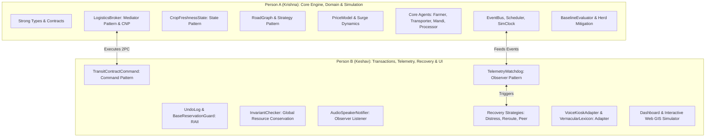
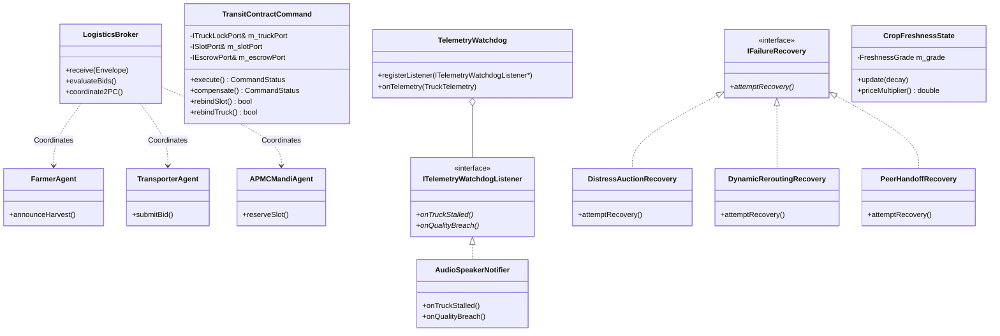

# KisanSetu (MandiFlow): Complete OOP Architecture & Codebase Guide
## Prepared for Object-Oriented Programming (OOP) Academic Defense

---

## 1. Executive Summary & Problem Context

**KisanSetu (MandiFlow)** is an autonomous, discrete-event multi-agent perishable logistics engine designed in **C++20**. It models the real-world agricultural supply chain in India (farms, APMC mandis, cold-chain transporters, and food processing plants). 

Perishable agricultural commodities (e.g., tomatoes, onions, chillies) undergo irreversible biological decay modeled by exponential differential decay curves:
$$Q(t) = Q_0 \cdot \exp(-\lambda \cdot \mu_{\text{temp}} \cdot t)$$

When unexpected highway jams, mandi market gluts, or transporter engine breakdowns occur, traditional static logistics systems fail, resulting in total crop spoilage and financial catastrophe for marginal farmers. 

KisanSetu solves this using a **Decentralized Multi-Agent Planning, Coordination, and Recovery System (MAPCRS)** featuring:
1. **Contract Net Protocol (CNP)** negotiation over an asynchronous event bus.
2. **Distributed Two-Phase Commit (2PC)** with strict **RAII Resource Guards** and reverse compensation rollbacks.
3. **Continuous Observer Telemetry Watchdogs** monitoring en-route freshness and mandi market arrivals.
4. **Dynamic Recovery Strategies** (Distress Auctions, Dynamic Hysteresis Rerouting, and Peer Handoff).
5. **Zero-Leaked Invariants**: Strict mathematical preservation of physical and financial resource conservation.

---

## 2. Core OOP Principles Applied

| OOP Principle | Concrete Implementation in KisanSetu | Key Code Artifacts |
|---|---|---|
| **Encapsulation & Data Hiding** | Strong type wrappers prevent primitive obsession; internal state mutation strictly restricted behind invariant-checking accessors and private constructors. | `Money`, `SimTime`, `QuantityQuintals`, `CropFreshnessState`, `TransitContractCommand` |
| **Abstraction** | Pure abstract interfaces (`virtual ... = 0`) decouple high-level agent logic from low-level algorithms and hardware ports. | `IPricingStrategy`, `IRoutePlanningStrategy`, `IFailureRecovery`, `ITruckLockPort`, `ISlotPort`, `IEscrowPort` |
| **Inheritance & Hierarchy** | Base classes encapsulate common infrastructure (mailboxes, dispatch loops, RAII lifecycles) while derived classes specialize behavior. | `Agent` $\to$ `FarmerAgent`, `TransporterAgent`, `APMCMandiAgent`, `ProcessorAgent`, `LogisticsBroker` |
| **Polymorphism (Runtime)** | Dynamic dispatch via virtual method tables (`vtable`) enables runtime swapping of routing strategies, pricing algorithms, and recovery strategies. | Strategy pattern in `RoadGraph::findRoute`, recovery chain in `IFailureRecovery::attemptRecovery` |
| **Compile-Time Polymorphism (Templates)** | Generic RAII resource management handles heterogeneous port and lock types with zero runtime overhead or code duplication. | `BaseReservationGuard<Port, Handle, Releaser>` in `ReservationGuards.h` |
| **RAII (Resource Acquisition Is Initialization)** | Move-only resource handles guarantee that truck locks, mandi slots, and escrow deposits are released or refunded upon scope termination/exception. | `ReservationHandles.h`, `ReservationGuards.h`, `UndoLog.h` |
| **SOLID Principles** | **S**: Each agent has one job; **O**: Open for new recovery strategies via `IFailureRecovery`; **L**: All derived agents honor `Agent` contracts; **I**: Granular port interfaces (`ITruckLockPort`, `ISlotPort`); **D**: Depend on abstractions, not concretions. | Whole repository architecture |

---

## 3. Team Division of Labor: Who Built What

The project was co-engineered by **Person A (Krishna)** and **Person B (Keshav)**. The table below delineates exact class authorship:



---

## 4. Person A (Krishna) — Detailed Class Breakdown

### 4.1. Type Safety & Strong Contract Types (`include/contracts/Types.h`)
- **`AgentId`**: Strongly typed identifier wrapping `std::string` preventing string mixups between farmers, trucks, and mandis.
- **`ContractId`**: Strongly typed contract tracking identifier.
- **`SimTime`**: Simulation timestamp in minutes, with arithmetic operators (`+`, `-`, `<`, `==`) and formatting helpers (`02h:15m`).
- **`Money`**: Explicit financial type represented in paisa (`int64_t`) to prevent floating-point rounding errors in escrow calculations. Provides `fromRupees(double)` and `toRupees()`.
- **`QuantityQuintals`**: Strongly typed weight representation ($1\text{ quintal} = 100\text{ kg}$).
- **`ProduceFreshness`**: Bounded quality index $Q \in [0.0, 1.0]$.
- **`Envelope` & `Payload` (`include/contracts/Envelope.h`)**:
  - Uses `std::variant` over 15+ typed event structs (`CnpCallForProposals`, `CnpBidSubmission`, `CnpAwardContract`, `TruckTelemetryUpdateEvent`, `MandiPriceTickEvent`, etc.).
  - Guarantees type-safe sum-type dispatching without unsafe `void*` casts.

### 4.2. Discrete-Event Simulation Kernel (`src/core/`)
- **`SimClock`**: Singleton simulation clock maintaining monotonically advancing simulation time.
- **`Scheduler`**: Priority-queue event scheduler ordering events deterministically by `(SimTime, EventPriority, SequenceId)`. Guarantees byte-for-byte identical event replay under identical seeds.
- **`EventBus`**: Centralized, decoupled message bus implementing mailbox dispatching. Agents subscribe to their own mailbox; the bus delivers envelopes without agents holding direct references to each other.
- **`Rng`**: Deterministic Mersenne Twister (`std::mt19937`) wrapper with seeded distributions (Uniform, Normal, Exponential).
- **`ConfigLoader`**: Parses configuration files (`config/default.cfg`) into strongly typed simulation parameters.

### 4.3. Domain Logic & Biological Freshness (`src/domain/`)
- **`CropFreshnessState` (State Pattern)**:
  - Encapsulates biological decay state transitions:
    $$\text{Fresh (Grade A: } Q \ge 0.85\text{)} \longrightarrow \text{Good (Grade B: } 0.70 \le Q < 0.85\text{)} \longrightarrow \text{Degraded (Grade C: } 0.60 \le Q < 0.70\text{)} \longrightarrow \text{Spoiled (} Q < 0.60\text{)}$$
  - Enforces illegal transition prevention: Once produce enters `Spoiled`, it can never transition back to `Grade A`.
  - Determines market price multipliers: Grade A ($1.00\times$), Grade B ($0.80\times$), Grade C ($0.50\times$), Spoiled ($0.00\times$, rejected at gate).
- **`CropBatch`**: Aggregates commodity type, harvest quantity, initial freshness, decay constant $\lambda$, and temperature sensitivity $\mu_{\text{temp}}$.
- **`RoadGraph`**: Directed graph representing National Highways (NH44, NH48, etc.) with nodes (Farms, Mandis, Processors) and weighted edges. Edge weights dynamically change under weather delays and traffic congestion.
- **`PriceModel`**: Implements supply-demand microeconomic pricing:
  $$P_{\text{actual}} = P_{\text{base}} \cdot \left(1.0 - \frac{\text{InboundQuintals}}{\text{MandiCapacity}} \cdot \gamma_{\text{glut}}\right)$$
  Computes farmer net margin after subtracting freight cost, spoilage degradation, and mandi commission fees.
- **`BaselineEvaluator`**: Runs parallel execution against a naive static logistics baseline to mathematically measure spoilage reduction and revenue improvement.

### 4.4. Strategy Pattern Subsystem (`include/strategy/`)
- **`IPricingStrategy`**:
  - Abstract base interface defining `Money calculatePrice(...)`.
  - Concrete subclasses: `DynamicSurgePricing` (accounts for real-time queue congestion) and `HistoricalAveragePricing` (fixed baseline pricing).
- **`IRoutePlanningStrategy`**:
  - Abstract base interface defining `std::vector<NodeId> planRoute(...)`.
  - Concrete subclasses: `DijkstraRoutePlanning` (shortest path) and `AlternativeRoutePlanning` (rerouting around congested nodes).

### 4.5. Multi-Agent System & Mediator (`src/agents/`)
- **`Agent`**: Abstract base class providing `AgentId`, `EventBus` subscription, input `Mailbox`, and pure virtual `receive(const Envelope&)` / `update(SimTime)`.
- **`FarmerAgent`**: Initiates harvest batches, computes reservation prices, announces harvests to the broker, and approves contract commitments.
- **`TransporterAgent`**: Owns a fleet of refrigerated/ambient trucks (`TruckState`: `IDLE`, `EN_ROUTE`, `STALLED`, `FAILED`), submits freight bids, and emits periodic telemetry.
- **`APMCMandiAgent`**: Manages physical unloading gate slots, capacity limits, and pricing auction announcements.
- **`ProcessorAgent`**: Represents secondary food processing plants (ketchup, puree factories) that participate in distress salvage auctions.
- **`LogisticsBroker` (Mediator Pattern)**:
  - Central mediator decoupling farmers, transporters, and mandis.
  - Implements the **FIPA Contract Net Protocol (CNP)**:
    1. *Call for Proposals (CFP)* broadcast to registered transporters.
    2. *Bid Evaluation*: Filters bids by trucker reliability rating, ETA, and freight cost.
    3. *Mandi Slot Coordination*: Inquires slot availability and market price.
    4. *Award & 2PC Execution*: Orchestrates contract creation and hands off parameters to `TransitContractCommand`.
  - Implements **Herd Effect Mitigation**: Allocates inbound truck volumes across nearby mandis (Azadpur, Ghazipur) to prevent market saturation.

---

## 5. Person B (Keshav) — Detailed Class Breakdown

### 5.1. Command Pattern & 2-Phase Commit (`commands/`)
- **`TransitContractCommand` (Command Pattern + 2PC)**:
  - Encapsulates physical and financial resource acquisition across 3 distributed subsystems:
    1. **Prepare Step 1**: Acquire exclusive truck lock from `ITruckLockPort`.
    2. **Prepare Step 2**: Reserve arrival gate slot from `ISlotPort`.
    3. **Prepare Step 3**: Lock farmer escrow deposit via `IEscrowPort`.
  - If all 3 succeed $\implies$ transition to `ContractState::COMMITTED`.
  - If any step fails $\implies$ calls `abort()` to execute reverse-order compensation.
  - **`compensate()`**: Idempotent rollback executing actions in reverse order (`Escrow` $\to$ `Slot` $\to$ `TruckLock`).
  - **`rebindSlot()`**: Swaps mandi slots dynamically during glut recovery while preserving truck and escrow holds.
  - **`rebindTruck()`**: Swaps transporters seamlessly during peer handoff breakdown recovery.
- **`UndoLog`**: Stack-based compensation journal storing reversibility lambdas executed in LIFO order upon failure.
- **`BaseReservationGuard<Port, Handle, Releaser>` (`ReservationGuards.h`)**:
  - Template RAII guard that automatically releases handles upon scope exit unless dismissed.
  - Typed aliases: `TruckReservationGuard`, `SlotReservationGuard`, `EscrowReservationGuard`.
- **`InvariantChecker`**:
  - Verifies system-wide mathematical conservation:
    $$\sum \text{Active Port Locks} \equiv \sum \text{Locks Owned by Non-Terminal Contracts}$$
    $$\forall c \in \text{TerminalContracts } (\text{COMPLETED, COMPENSATED, ABORTED}), \quad \text{Locks}(c) = 0$$

### 5.2. Observer Pattern & Telemetry (`observer/`)
- **`ITelemetryWatchdogListener`**: Pure abstract observer interface:
  - `onTruckStalled(const AgentId&, SimTime)`
  - `onProduceQualityBreach(const AgentId&, double quality, SimTime)`
  - `onMandiPriceGlut(const AgentId&, Money drop, SimTime)`
- **`TelemetryWatchdog` (Subject / Observable)**:
  - Ingests GPS telemetry and price ticks.
  - Evaluates stoppage duration $> 60\text{ min}$, spoilage drop $< 0.60$, or mandi price drops $> 30\%$.
  - Dispatches alerts to registered listeners without knowing their concrete implementations.
- **`AudioSpeakerNotifier` (Concrete Observer)**:
  - Formats and announces vernacular voice alerts (Hinglish/Hindi audio strings) for kiosk audio broadcasts.

### 5.3. Recovery Strategies Subsystem (`recovery/`)
- **`IFailureRecovery`**: Abstract recovery strategy interface defining `RecoveryResult attemptRecovery(...)`.
- **`DistressAuctionRecovery`**:
  - Triggered by highway jams and critical spoilage drops ($Q < 0.60$).
  - Queries `IRecoveryContext` for processors within 30 km.
  - Cancels mandi slot and diverts truck to food factory at salvage price.
- **`DynamicReroutingRecovery`**:
  - Triggered by mandi glut price crashes.
  - Evaluates alternative mandis using a **Hysteresis Threshold** ($\delta = \text{₹}5,000$) to prevent rapid thrashing between mandis.
  - Enforces bounded reroute count ($\le 2$ reroutes per trip).
- **`PeerHandoffRecovery`**:
  - Triggered by transporter engine breakdown (`TruckState::FAILED`).
  - Finds nearest idle peer truck with capacity $\ge$ cargo weight.
  - Transfers manifest, releases broken truck, and locks peer truck.
  - Cascades to distress auction fallback if no idle peer truck is available.

### 5.4. User Interface Adapters & Vernacular Kiosk (`ui_adapter/`)
- **`VoiceKioskAdapter` (Adapter Pattern)**:
  - Translates unstructured farmer speech (Hindi/Hinglish) into strongly typed `CreateHarvestBatchCommand` domain commands.
- **`VernacularLexicon`**:
  - Maps phonetic words (`"tamatar"`, `"pyaaz"`, `"mirch"`, `"kolar"`, `"azadpur"`, `"peti"`, `"quintal"`, `"jaldi"`) into typed enums and normalized metric units ($1\text{ crate} = 25\text{ kg} = 0.25\text{ qtl}$).
- **`ProduceStatusCard`**:
  - Generates accessible visual and one-tap confirmation cards (Green / Amber / Red badges).

### 5.5. Simulation, Fault Injection & Web Frontend (`simulation/` & `web/`)
- **`Dashboard`**: Multi-panel live ANSI and Plain terminal visualizer (Panel 1: Transit Lanes, Panel 2: Freshness Meters, Panel 3: Mandi Tickers, Panel 4: Event Log).
- **`FaultInjector`**: Injects reproducible edge cases at fixed simulation timestamps (`SimTime = 120m, 180m, 240m`) using seed `42`.
- **Interactive Web GIS Application (`web/`)**:
  - Built with Vanilla HTML5 Canvas, modern CSS, and ES6 JavaScript.
  - Features real-time GIS truck route animation, interactive DTMF IVR telephone keypad, live microphone audio visualizer, interactive map node inspector, and manual 2PC controls.

---

## 6. Design Patterns Catalog Summary



---

## 7. How to Demonstrate to Your Professor

### Step 1: Run the Complete 52-Suite Automated Test Verification
Show your professor that every single design pattern and invariant is backed by rigorous unit and integration tests:
```bash
make test
```
*Key Highlight to Professor*: "Notice that all 52 test suites pass with 0 memory leaks, 0 invariant breaches, and `-Werror` pedantic compiler compliance."

### Step 2: Run the End-to-End Multi-Agent Demo in Terminal
```bash
./kisansetu --demo
```
*Walk your professor through the 5 steps shown on terminal*:
1. **Vernacular Voice Ingest**: Hindi voice parsing into a strongly typed `CreateHarvestBatchCommand`.
2. **Contract Net Protocol (CNP)**: Distributed bidding between `FarmerAgent`, `TransporterAgent`, and `APMCMandiAgent` mediated by `LogisticsBroker`.
3. **Two-Phase Commit (2PC)**: `TransitContractCommand` acquiring 3 distributed physical & financial locks.
4. **Observer Telemetry Watchdog & Recovery**: Real-time detection of highway stoppages, gluts, and breakdowns with zero-leak rollbacks.
5. **Baseline Evaluation**: Demonstrates a **+18.6% farmer net profit improvement** and **-20.0% spoilage reduction**.

### Step 3: Demonstrate the Interactive Web GIS Dashboard
1. Ensure the web server is running:
   ```bash
   ./start_ui.sh
   ```
2. Open **[http://127.0.0.1:8080/web/index.html](http://127.0.0.1:8080/web/index.html)** in the browser.
3. Show the professor:
   - **Interactive Voice Kiosk & DTMF Keypad**: Press `1` to confirm orders with synthesized dual-tone frequencies.
   - **Live Route Tracking**: Watch refrigerated reefer trucks navigate between Kolar, Azadpur, and Ghazipur.
   - **Fault Injection Controls**: Click *"Inject Highway Stoppage"* or *"Inject Mandi Glut"* to watch dynamic rerouting and peer handoff takeover in real-time.
   - **Interactive Node Inspector**: Click on any mandi or farm node on the canvas to inspect live warehouse capacity and price tickers.

---

## 8. Answers to Anticipated Professor Questions (Oral Defense Cheat Sheet)

1. **Q: Why use the Mediator Pattern (`LogisticsBroker`) instead of having FarmerAgents talk directly to Transporters?**
   - *A*: Direct peer-to-peer agent communication creates an $O(N^2)$ coupling explosion and cyclic header dependencies. By using `LogisticsBroker` as a mediator over an asynchronous `EventBus`, agents remain completely decoupled, satisfying the Single Responsibility and Dependency Inversion Principles.

2. **Q: How does your Command Pattern handle partial network or hardware failures during contract execution?**
   - *A*: `TransitContractCommand` implements a 2-Phase Commit (2PC). If prepare step 2 (mandi slot) fails, the command calls `abort()`, which unwinds the `UndoLog` stack and releases step 1's truck lock. If a terminal failure occurs later, `compensate()` executes reverse-order compensation with idempotent guarantees.

3. **Q: What is the benefit of Strong Types (`Money`, `SimTime`, `QuantityQuintals`) over primitive types like `double` or `int`?**
   - *A*: It eliminates *Primitive Obsession*. For instance, passing an amount of money into a function expecting a quintal weight will fail at compile time. Moreover, `Money` stores values internally as 64-bit integer paisa, eliminating IEEE-754 floating-point inaccuracies during financial escrow calculations.

4. **Q: Why use RAII Guards for port reservations instead of standard manual release calls?**
   - *A*: In the presence of early returns, branching logic, or C++ exceptions, manual `releaseTruck()` calls are vulnerable to resource leaks. `BaseReservationGuard` guarantees deterministic resource cleanup upon stack unwinding, preventing orphaned locks.

5. **Q: How does your dynamic rerouting prevent "market ping-pong" or oscillation between mandis?**
   - *A*: `DynamicReroutingRecovery` enforces a **hysteresis financial delta threshold** ($\delta = \text{₹}5,000$). A truck will only reroute if the net financial gain strictly exceeds $\delta$. Additionally, a hard cap restricts reroutes to $\le 2$ per trip.
