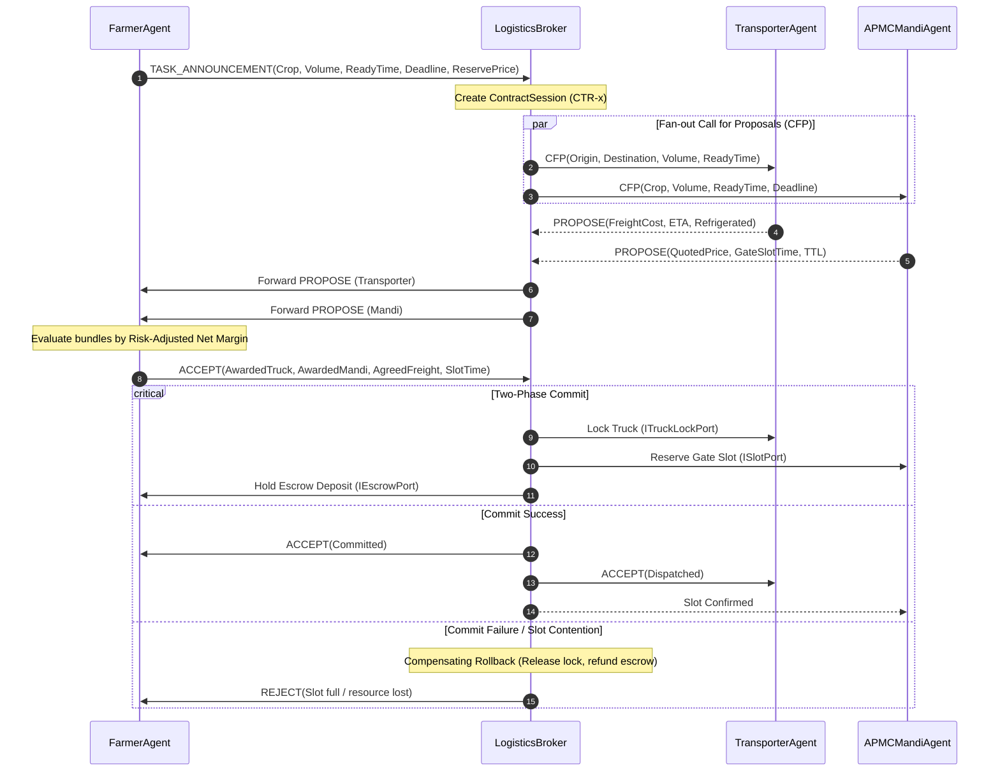

# KisanSetu (MandiFlow) - System Design & Architecture

## 1. Overview & System Architecture

KisanSetu is an advanced discrete-event, multi-agent planning, coordination, and recovery simulation (MAPCRS) of agricultural logistics across Indian APMC mandis. 

The architecture enforces strict decoupling between agents and infrastructure using the **Mediator**, **State**, and **Strategy** design patterns.

```
                           +-------------------+
                           |    SimClock &     |
                           |    Scheduler      |
                           +---------+---------+
                                     |
                                     v
+-------------------+      +---------+---------+      +-------------------+
|    FarmerAgent    |<---->|     EventBus      |<---->| TransporterAgent  |
+-------------------+      +---------+---------+      +-------------------+
         ^                           ^                          ^
         |                           |                          |
         v                           v                          v
+-------------------+      +---------+---------+      +-------------------+
|  APMCMandiAgent   |<---->|  LogisticsBroker  |<---->|  ProcessorAgent   |
|   (Slot Port)     |      |    (Mediator)     |      |  (Distress Bid)   |
+-------------------+      +---------+---------+      +-------------------+
                                     |
                     +---------------+---------------+
                     |                               |
                     v                               v
          +--------------------+          +--------------------+
          |  RoadGraph Network |          |  Commodity & Decay |
          |   (Mutable Edges)  |          |   State Machine    |
          +--------------------+          +--------------------+
```

---

## 2. Core Components & Ownership (Person A)

### Core Engine (`core/`)
- **`SimClock`**: Tracks discrete simulation time ($1\text{ tick} = 1\text{ minute}$).
- **`Scheduler`**: Deterministic event priority queue ordered by `(simTime, sequenceNumber)`.
- **`EventBus`**: Dispatches immutable message `Envelope`s into agent mailboxes. Supports simulated network latency and Bernoulli packet loss.
- **`Rng`**: Deterministic 64-bit Mersenne Twister engine (`std::mt19937_64`) seeded for byte-for-byte reproducibility.
- **`Agent`**: Base class providing thread-safe message queues and private state encapsulation.

### Domain Models (`domain/`)
- **`Commodity`**: Type-safe produce profiles (Tomato, Onion, Chilli) with calibrated decay constants ($\lambda$) and base prices.
- **`CropFreshnessState`**: State pattern implementing formal grade transitions:
  - **Grade A** ($Q \ge 0.85$, multiplier $1.00$)
  - **Grade B** ($0.65 \le Q < 0.85$, multiplier $0.75$)
  - **Grade C** ($0.40 \le Q < 0.65$, multiplier $0.45$)
  - **Spoiled** ($Q < 0.40$, multiplier $0.00$)
- **`RoadGraph`**: Dynamic road graph with mutable edge travel times, toll fees, and real-time congestion multipliers.
- **`PriceModel`**: Implements mandi surge pricing and farmer net margin calculations.

### Strategy Interfaces (`strategy/`)
- **`IRoutePlanningStrategy`**: Pluggable graph traversal:
  - `DijkstraRouteStrategy`: Shortest travel time.
  - `SpoilageMinimizingRouteStrategy`: Minimal thermal decay.
  - `TollAverseRouteStrategy`: Cost minimization penalizing highway tolls.
- **`IPricingStrategy`**: Dynamic surge pricing and periodic uniform-price call auction clearing.

---

## 3. Coordination Protocol: Tripartite CNP

The Contract Net Protocol (CNP) coordinates autonomous entities via the `LogisticsBroker` mediator:



---

## 4. Recovery & Rerouting Architecture

### Two-Phase Commit Rollback
If a gate slot is contested or unavailable at the time of commit, the broker invokes `rollbackSession()`:
1. Refunds any held escrow deposit (`IEscrowPort::refundDeposit`).
2. Cancels reserved gate slot (`ISlotPort::cancelSlot`).
3. Releases locked transporter (`ITruckLockPort::releaseTruck`).
4. Logs cancellation to the append-only `EventLog` and notifies the farmer.

### Inbound Surge Forecasting & Herd-Effect Mitigation
To prevent alternative mandis from suffering massive congestion during multi-truck rerouting:
- The broker maintains `inboundTrucksPerMandi_`.
- When evaluating candidates in `IRecoveryContext::rankMandis()`, each candidate's projected price includes the surge penalty:
  $$P_{\text{forecast}} = P_{\text{base}} \cdot \max\left(0.40, 1.0 - 0.50 \cdot \max\left(0.0, \frac{\text{arrivals} + \text{inbound}}{\text{capacity}} - 1.0\right)\right)$$
- Subsequent trucks naturally diverge toward less congested alternatives, avoiding herding behavior.

### Hysteresis Threshold $\delta$ & Reroute Cap
- Rerouting is approved only if:
  $$\Delta \text{Margin} = \text{NetMargin}_{\text{alternate}} - \text{NetMargin}_{\text{current}} > \delta \quad (\delta = \text{₹}5,000)$$
- A strict reroute cap ($\le 2$ attempts per contract) prevents oscillation and computational thrashing.

---

## 5. Concurrency Model

KisanSetu supports two execution modes:
1. **Single-Threaded Reference Mode**:
   - Discrete-event scheduler guarantees 100% byte-for-byte identical event logs across identical seeds.
2. **Parallel Mode (`--parallel`)**:
   - Each agent owns a thread-safe mutex-guarded mailbox.
   - Events scheduled for the same simulation tick are delivered and executed concurrently across worker threads.
   - The `LogisticsBroker` serializes contract commits to prevent race conditions on shared physical gate quotas.
