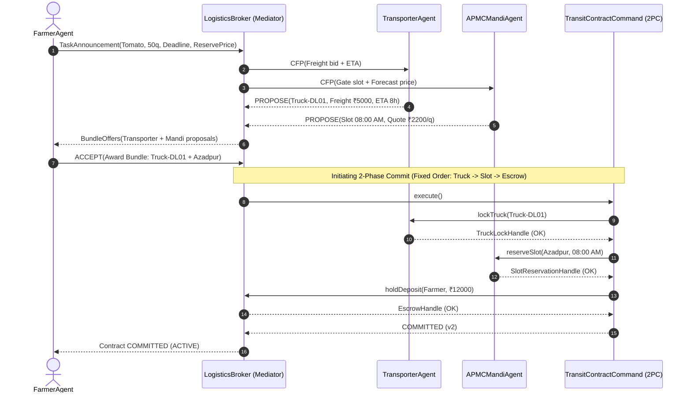
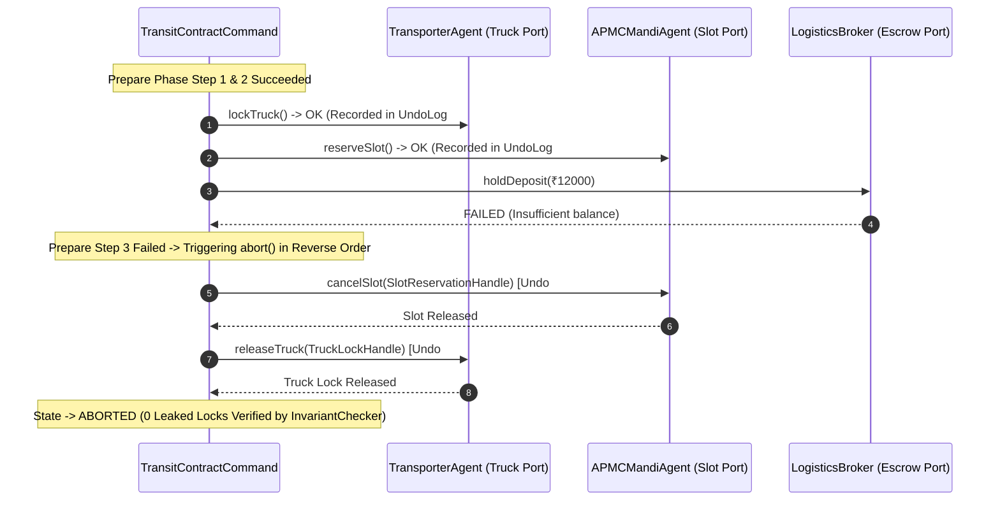

# KisanSetu (MandiFlow) – System Sequence Diagrams

This document contains Mermaid sequence diagrams illustrating decentralized coordination, two-phase commitment, reverse compensation, and the three recovery strategies.

---

## 1. Tripartite Contract Net Protocol (CNP) & Two-Phase Commit (2PC)



---

## 2. Reverse-Order Compensating Rollback (Step 3 Escrow Failure Example)



---

## 3. Fault Scenario 1: Highway Stoppage & Distress Auction Recovery

```mermaid
sequenceDiagram
    autonumber
    participant Truck as TransporterAgent
    participant Watchdog as TelemetryWatchdog (Observer)
    participant Notifier as AudioSpeakerNotifier
    participant Recovery as DistressAuctionRecovery
    participant Cmd as TransitContractCommand
    participant Context as IRecoveryContext
    participant Mandi as APMCMandiAgent
    participant Processor as Tropicana Processing Plant

    Note over Truck: Highway Stall (+7h Delay on NH44)
    Truck->>Watchdog: TelemetryUpdate(speed=0, arrivalETA=15h, Q_pred=0.583)
    Note over Watchdog: Predicate: Q_pred (0.583) < Mandi Floor (0.60)
    Watchdog->>Notifier: onAnomalyAlert(HighwayStoppage)
    Notifier-->>Truck: [🔊 SPEAKER] "Tamatar kharab hone se bachane factory bheja ja raha hai."
    Watchdog->>Recovery: recover(contract, context, alert)

    Recovery->>Context: findProcessors(location="NH44", maxRadiusKm=30.0)
    Context-->>Recovery: [Kissan (25km, ₹950), Tropicana (15km, ₹1050)]
    Note over Recovery: Winner: Tropicana (Within 30km, Highest Net Bid ₹1050/q)

    Recovery->>Cmd: divertToProcessor(Tropicana_Plant, ₹1050)
    Cmd->>Mandi: cancelSlot(oldSlot)
    Mandi-->>Cmd: Mandi Slot Released (0 Leaked Slots)
    Cmd-->>Recovery: Diverted OK (Contract v3)
    Note over Cmd,Processor: Truck delivers to Tropicana Plant; Sale settled at processing price
```

---

## 4. Fault Scenario 2: Mandi Glut & Dynamic Rerouting with Hysteresis

```mermaid
sequenceDiagram
    autonumber
    participant Mandi as APMCMandiAgent (Azadpur)
    participant Watchdog as TelemetryWatchdog
    participant Notifier as AudioSpeakerNotifier
    participant Recovery as DynamicReroutingRecovery
    participant Context as IRecoveryContext
    participant Cmd as TransitContractCommand
    participant NewMandi as APMCMandiAgent (Ghazipur)

    Note over Mandi: 50 Unannounced Trucks Arrive (Supply Surge)
    Mandi->>Watchdog: PriceTick(Azadpur, Price=₹1320/q < Reserve ₹1800/q)
    Watchdog->>Notifier: onAnomalyAlert(MandiGlut)
    Notifier-->>Mandi: [🔊 SPEAKER] "Azadpur me bhaav gir gaya hai, reroute kiya ja raha hai."
    Watchdog->>Recovery: recover(contract, context, alert)

    Recovery->>Context: rankMandis(exclude=[Azadpur])
    Context-->>Recovery: [Ghazipur (NetMargin=₹16500), Kolar (NetMargin=₹3000)]
    
    Note over Recovery: Hysteresis Check: Net Gain (₹16500) > Delta Threshold (₹5000) -> OK
    Note over Recovery: Bounded Attempts Check: Attempt 1 of 2 -> OK

    Recovery->>Cmd: rebindSlot(Ghazipur, Slot 09:00 AM)
    Cmd->>Mandi: cancelSlot(oldAzadpurSlot)
    Mandi-->>Cmd: Released
    Cmd->>NewMandi: reserveSlot(Ghazipur, 09:00 AM)
    NewMandi-->>Cmd: New Slot Reserved
    Cmd-->>Recovery: Slot Rebound (Contract v3)
    Note over Cmd: Truck diverted to Ghazipur; Old slot freed, New slot locked
```

---

## 5. Fault Scenario 3: Transporter Breakdown & Peer Handoff with Fallback

```mermaid
sequenceDiagram
    autonumber
    participant Truck1 as TransporterAgent (Failed Truck-DL01)
    participant Watchdog as TelemetryWatchdog
    participant Notifier as AudioSpeakerNotifier
    participant Recovery as PeerHandoffRecovery
    participant Context as IRecoveryContext
    participant Cmd as TransitContractCommand
    participant Truck2 as Peer TransporterAgent (Truck-DL99)

    Note over Truck1: Engine Breakdown on NH44 (State -> FAILED)
    Truck1->>Watchdog: TelemetryUpdate(State=FAILED)
    Watchdog->>Notifier: onAnomalyAlert(TransporterFailure)
    Notifier-->>Truck1: [🔊 SPEAKER] "Truck ka engine kharab hua hai. Doosra truck aa raha hai."
    Watchdog->>Recovery: recover(contract, context, alert)

    Recovery->>Context: findIdleTrucks(location="NH44_Junction", capacity=50q)
    Context-->>Recovery: [Truck-DL99 (Idle at NH44, Cap 50q)]

    Recovery->>Cmd: rebindTruck(Truck-DL99)
    Cmd->>Truck1: releaseTruck(Truck-DL01)
    Truck1-->>Cmd: Released
    Cmd->>Truck2: lockTruck(Truck-DL99)
    Truck2-->>Cmd: Locked
    Cmd-->>Recovery: Truck Rebound (Contract v3)

    Note over Truck1,Truck2: Cargo Manifest Transferred at Rendezvous; Cargo Continues with 0 Leaks
```

---

## 6. Vernacular Voice Kiosk & One-Click Confirmation Flow

```mermaid
sequenceDiagram
    autonumber
    actor Farmer as Farmer
    participant Adapter as VoiceKioskAdapter (Adapter Pattern)
    participant Lexicon as VernacularLexicon
    participant Agent as FarmerAgent (Simulation Core)

    Farmer->>Adapter: VoiceInput("50 crates tamatar bechna hai")
    Adapter->>Lexicon: matchQuantity("50") -> 50.0
    Adapter->>Lexicon: matchUnit("crates") -> Crate (25 kg/crate)
    Adapter->>Lexicon: matchCrop("tamatar") -> Tomato
    Adapter->>Lexicon: matchIntent("bechna") -> Sell
    Adapter->>Lexicon: normalizeToQuintals(50, Crate) -> 12.5 Quintals

    Note over Adapter: Generates CreateHarvestBatchCommand + ConfirmationCard
    Adapter-->>Farmer: Render ConfirmationCard: "Kya aap 50 peti tamatar bechna chahte hain?"
    Farmer->>Adapter: ButtonTap("GREEN_TICK")
    Adapter->>Agent: ConfirmContractCommand(confirmed=true)
    Note over Agent: Engine executes contract; Safe from voice misrecognition
```
